# F2C23T Custom Firmware

Custom firmware for the F2C23T handheld multimeter, oscilloscope, and signal generator.

The goal of this repository is to provide an open, improved firmware base for the device with a cleaner UI, better controls, USB storage support, screenshots, in-app firmware updates, and separate builds for the known hardware revisions.

This firmware is still under active development. Use it at your own risk.

## Screenshots

| | | |
|---|---|---|
| 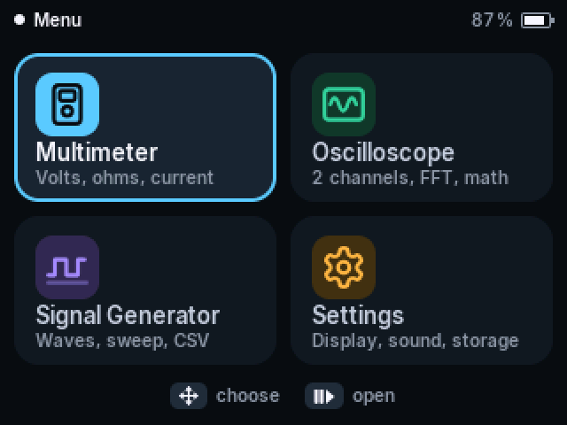 | 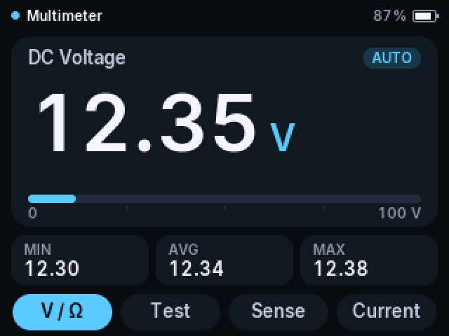 | 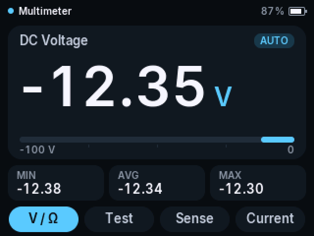 |
| 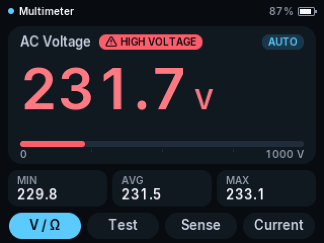 | 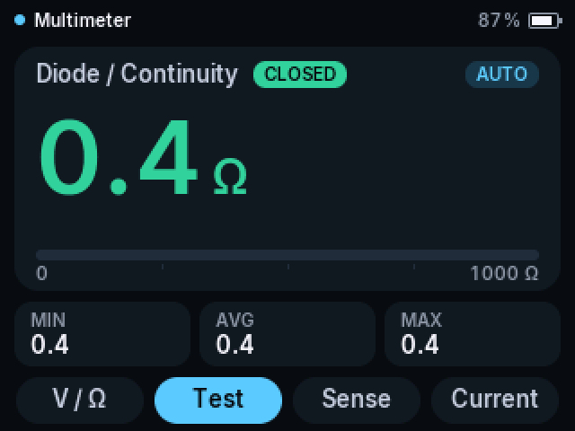 | 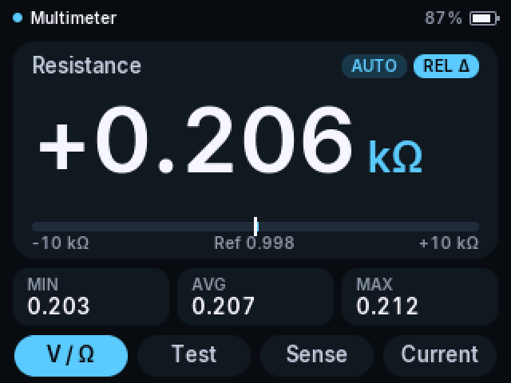 |
| 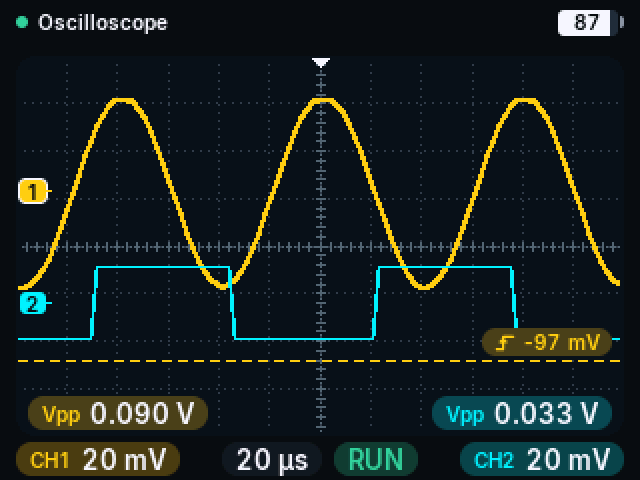 | 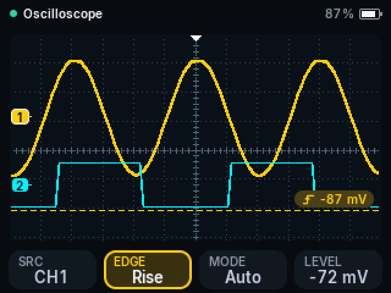 | 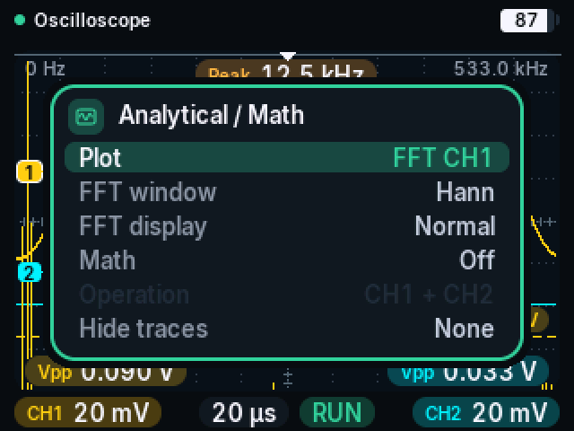 |
| 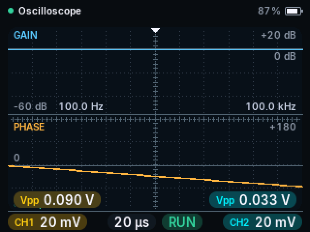 | 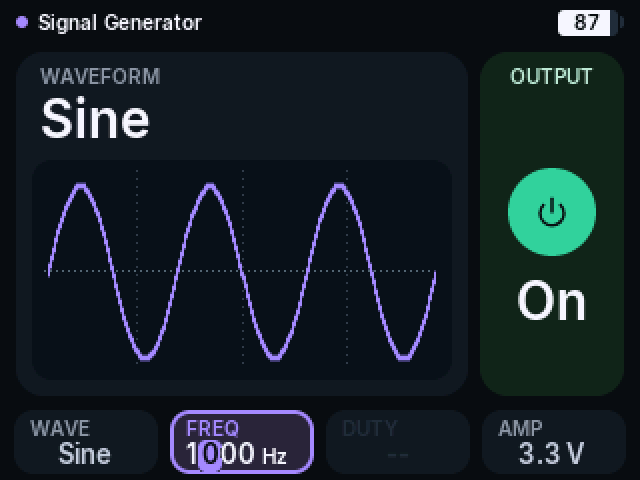 | 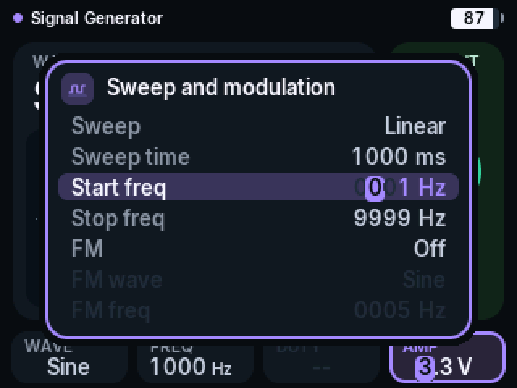 |
| 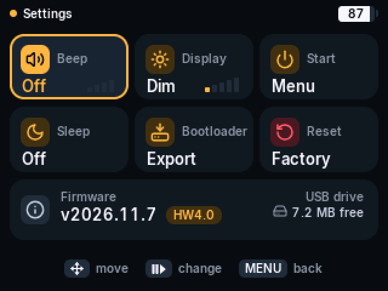 | 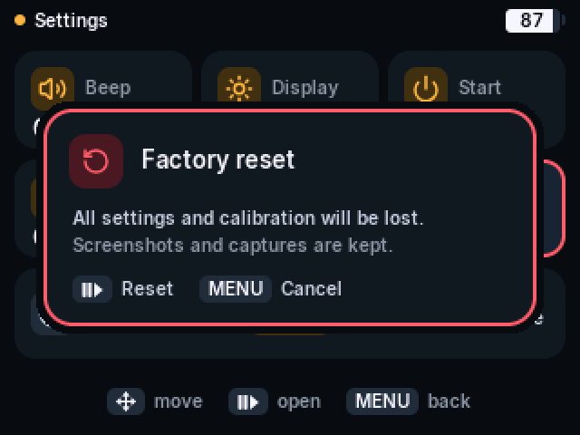 | 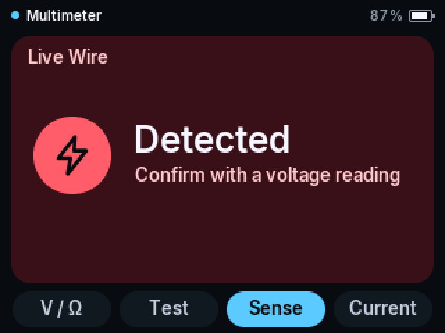 |

These images are rendered on a PC by the firmware's own drawing code (`make screenshots`), so they match the 320×240 screen pixel for pixel, shown at 2× without smoothing. Signals and readings in them are synthetic test inputs. Every state of every screen (waiting, negative readings, OL, REL, AUTO detect, warnings and more) is listed in [`docs/screenshots`](docs/screenshots/README.md).

## What This Adds

In addition to the stock multimeter, oscilloscope, and signal generator functions, this firmware adds:

- **Extended signal-generator waveforms:** sine, square, triangle, sawtooth, half wave, full wave, noise, DC, positive/reverse step, exponential rise/fall, multi-audio, sinker pulse, Lorentz, and arbitrary CSV waveforms.
- **True RMS oscilloscope measurement** based on captured samples instead of the simplified stock-style approximation.
- **Oscilloscope Analytical / Math menu** opened by long-pressing `CH1`, with channel math, XY mode, trace hiding, FFT, and Bode plot tools.
- **FFT spectrum view** with selectable window functions plus normal, averaging, and max-hold displays.
- **Signal-generator sweep and FM menu** opened by long-pressing `CH1`, with linear/logarithmic sweeps and sine, triangle, or square frequency modulation.
- **Arbitrary waveform playback from CSV files** stored on the device's USB drive. See the ready-to-use [sine](examples/sine.csv) and [action-potential](https://github.com/user-attachments/files/29925821/HH.csv) examples.
- **Modern interface** for every screen: a flat dark theme with rounded cards, anti-aliased Inter type, Lucide-style icons, proper unit symbols (Ω, µ, °C) and one colour per tool. See [Interface](#interface).
- **Multimeter screen** with a large reading, a bar graph against the meter's current range (centred on zero in REL mode), a MIN / AVG / MAX row, and a dedicated live-wire card.
- **Improved oscilloscope controls** with channel menus, trigger setup, move/cursor/measurement menus, rolling display, and clearer scale/readout handling.
- **Runtime USB mass storage** while the device is running.
- **USB serial telemetry and remote control** with 300-point scope traces and signal-generator controls while viewing the scope.
- **In-app firmware update** by copying a matching `F2C23T*.bin` file to the exposed USB storage.
- **Screenshot capture** to the device storage by long-pressing `SAVE` (saved as `IMG_NN.BMP`), with the USB `SHOT` command and remote button presses via `KEY:<NAME>`.
- **Read-only bootloader export** from Settings, with hardware-specific backups and CRC32 metadata.
- **Configurable settings** for brightness, beep volume, sleep behavior, and startup screen, plus hardware target, free storage, and a confirmed factory reset.
- **Separate release binaries** for old and newer hardware revisions.

## Interface

Every tool uses one visual language: a status bar (tool name, USB, charging and battery), rounded cards, and rows of rounded chips for the settings you change with the arrow keys. The selected chip or row is outlined in the tool's colour: blue for the multimeter, green for the oscilloscope, violet for the signal generator, and amber for settings.

- **Main menu (`MENU`):** a 2×2 grid. Use the arrow keys (left/right and up/down) to choose and `‖▶` to open.
- **Multimeter:** the four group keys (V/Ω, Test, Sense, Current) are shown as pills at the bottom. HOLD, REL and AUTO/MANUAL appear as tags on the reading card. Readings above 30 V AC or 60 V DC turn red and get a solid HIGH VOLTAGE tag (30–60 V DC: amber CAUTION). An open circuit or overload reads OL.
- **Bar graph:** the meter shows four digits, so its decimal point marks its current range ("12.35" V is on the 0–100 V range). The bar shows the reading against that range and only rescales when the meter changes range. Negative readings fill from the right on a −range…0 axis. In REL the bar is centred on zero and spans ±range. Temperature has no bar.
- **Continuity:** in the Diode / Continuity mode the resistance stays the big number; below 50 Ω it turns green and a small CLOSED tag appears.
- **Live wire:** put the red lead in the V jack and touch the probe tip to the wire. It is a single-probe phase check, so confirm with a voltage measurement.
- **Oscilloscope:** a dotted graticule, numbered channel tags, a trigger-level tag with an edge icon, measurement pills, and a bottom bar with CH1/CH2 V/div, the timebase and RUN/HOLD/ROLL. The Analytical / Math, FFT and Bode views use the same style.
- **Signal generator:** a waveform card with a live preview, an Output card (green when on), and digit-by-digit editors for frequency, duty cycle and amplitude.
- **Settings:** tiles with icons and level meters, an info card (firmware version, hardware revision, free USB space), and rounded confirmation dialogs.

### Fonts, icons and screenshots

- **Type:** Inter (SIL Open Font License 1.1, [`tools/fonts/Inter-LICENSE.txt`](tools/fonts/Inter-LICENSE.txt)), pre-rendered as 4-bit anti-aliased glyphs in `src/ui_fonts.c` (about 24 KB of flash).
- **Icons:** Lucide (ISC licence, [`tools/icons/LUCIDE-LICENSE.txt`](tools/icons/LUCIDE-LICENSE.txt)), plus a few icons drawn in the same style (multimeter, oscilloscope, generator, the `‖▶` key and the trigger edges). They are stored as one more font, so the text renderer draws them.
- **Regenerating the fonts and icons:**

  ```sh
  node tools/render_icons.js /path/to/lucide-static/icons tools/icons
  python3 tools/gen_fonts.py /path/to/Inter/extras/ttf tools/icons src/ui_icons.h > src/ui_fonts.c
  ```

- **Rendering every screen on a PC:** `make preview` writes the exact framebuffers to `build/preview/`, and `make screenshots` refreshes `docs/screenshots/` (needs Python with Pillow).

## FFT Spectrum

The oscilloscope includes an FFT spectrum view for inspecting the dominant frequency and harmonic content of the captured signal.

To open it:

1. Open `Oscilloscope` from the main menu.
2. Long-press `CH1` to open the `Analytical / Math` menu.
3. Use the up/down arrow keys to move through the menu items.
4. Use the left/right arrow keys to change the selected item.
5. Set `FFT MODE` to `CH1 ENABLED` or `CH2 ENABLED`.
6. Press the center `OK/HOLD` button or `MENU` to close the menu.

Use the regular oscilloscope channel, voltage/div, and time/div controls to adjust the captured signal before viewing the spectrum.

Screenshots of the FFT view can be added here.

## Signal Generator Sweep and FM

Long-press `CH1` while the signal generator is open to access the `Sweep and Modulation` menu. It provides linear and logarithmic frequency sweeps as well as sine, triangle, and square frequency modulation.

Use the up/down arrow keys to select a setting and the left/right arrow keys to change it. Press the center `OK/HOLD` button or `MENU` to close the menu.

## Arbitrary CSV Waveforms

The signal generator can load custom single-period waveforms from CSV files stored in the root directory of the device's USB drive. Directly usable examples are available for a [sine wave](examples/sine.csv) and a 1,024-point [action potential](https://github.com/user-attachments/files/29925821/HH.csv).

CSV requirements:

- One to 2,048 integer samples representing one complete waveform period.
- Sample values from `0` (minimum output) to `255` (maximum output).
- One value per line is recommended; commas and other non-numeric separators are also accepted.
- Use a short filename with no more than eight characters before `.csv`, for example `sine.csv`.
- Store no more than eight waveform CSV files in the root directory.

After copying the file, select `ARBITRARY` as the generator waveform. The frequency field becomes the CSV file selector; use the up/down arrow keys to choose a file. The firmware interpolates the supplied samples across the FPGA's 2,048-sample waveform buffer.

## Build

The default build targets devices older than HW4.0:

```sh
make
```

Release builds create both hardware targets:

```sh
make release
```

Output files:

- `dist/F2C23T-v2026.11.5-08008000.bin`
- `dist/F2C23T-v2026.11.5-HW4.0-08007000.bin`

If no Rust toolchain provides `rust-lld`, point the build at the system LLVM linker:

```sh
make release RUST_LLD=$(which ld.lld)
```

Run the host regression tests with Clang:

```sh
make test
```

These tests cover DMM decoding and UART framing, scope/FFT measurements, generator state transitions, both FPGA timing transports, bootloader read protection, and FAT backup export with mocked hardware and address/undefined-behavior sanitizers. They do not replace testing on a device.

## Bootloader Backup

Open `Settings`, select `BOOTLOADER / EXPORT`, and press `PLAY/OK`. If USB is connected to a computer, safely eject the drive before confirming with `PLAY/OK` again; the cable can stay connected. `MENU` cancels the confirmation. The drive temporarily disconnects during export and reconnects afterwards. Ejecting avoids pending host filesystem writes; no computer or USB connection is required to create the backup.

The export creates two files in the drive's root directory:

- Older hardware: `boot_old.bin` (32 KiB) and `boot_old.txt`.
- HW4.0: `boot_hw4.bin` (28 KiB) and `boot_hw4.txt`.

The `.bin` contains the internal flash from `0x08000000` up to, but not including, the application start address. The `.txt` records the build target, firmware version, address, size, and CRC32 checksum. Data is read back and verified before the files are published. Exporting again replaces the existing `.bin` and `.txt` backups under the same filenames.

This function never erases or programs the MCU's internal flash and never changes protection settings. It refuses protected regions or invalid bootloader vectors. It exports the bootloader currently present on the device, not the immutable MCU ROM DFU loader, and does not restore or repair it. Verification checks the copy, not the correctness of the bootloader. Use a working donor with the same hardware revision for recovery; do not flash an older-hardware bootloader onto HW4.0 without checking compatibility.

## Installation

Download the correct `.bin` file from the release assets:

- Use `F2C23T-v2026.11.5-08008000.bin` if your device did **not** already have firmware `2.1.0` installed.
- Use `F2C23T-v2026.11.5-HW4.0-08007000.bin` if your device already came with, or was already running, firmware `2.1.0`.

When upgrading to v2026.11.4, saved settings and user calibration from older OpenScope builds are not carried over. The new settings signature prevents data from another firmware from being interpreted as OpenScope settings.

To flash the firmware with the built-in bootloader:

1. Turn the device off.
2. Hold the `MENU` button.
3. While holding `MENU`, press the power button.
4. Connect the device to your computer by USB.
5. A USB drive should appear.
6. Copy the selected `.bin` file to that drive.
7. Wait until the copy has finished and the device has flashed the firmware.
8. Restart the device.

The bootloader is not modified by this firmware. If the application firmware does not boot, you should still be able to enter bootloader mode again with `MENU` + power and flash another firmware file. In normal use this means there is no permanent brick risk from flashing the application firmware.

## Hardware Versions

There are at least two hardware variants:

- `<HW4.0`: older hardware, app start at `0x08008000`, old FPGA transport.
- `HW4.0`: newer hardware, app start at `0x08007000`, newer FPGA bitstream and GPIOC parallel FPGA transport.

The older hardware build is the primary tested target at the moment. The newer HW4.0 build exists, but still needs real-device testing to confirm that oscilloscope, signal generator, multimeter, storage, and firmware update behavior all work correctly.

## Project Status

The firmware already covers the core workflows, but there are certainly still things that can be improved, cleaned up, optimized, or made more accurate. Contributions, testing feedback, and hardware-specific findings are welcome.
